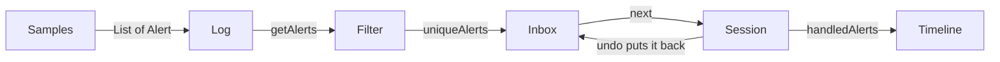
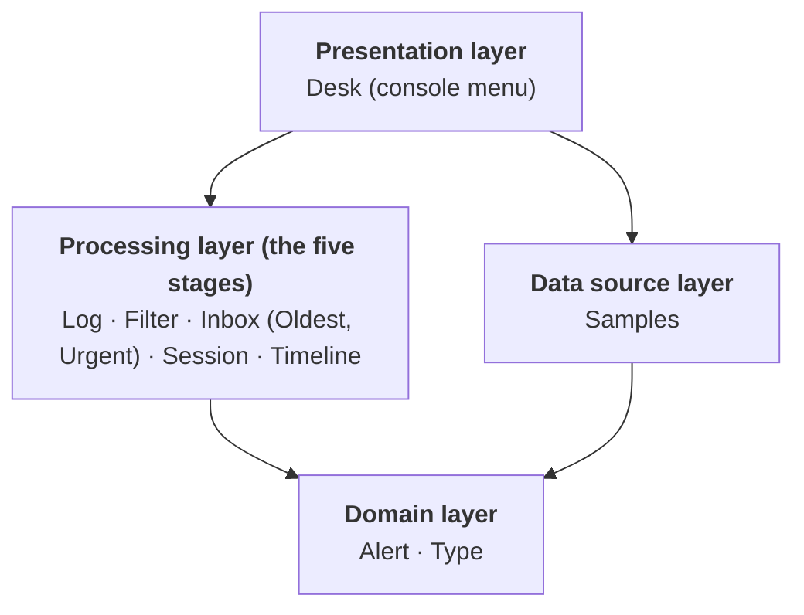
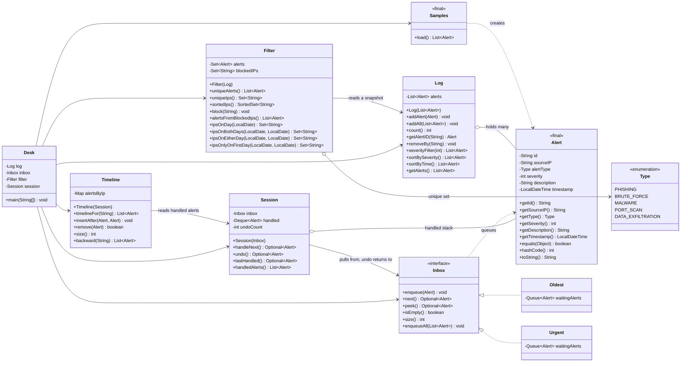

# SOC Alert Desk

A Java console application that models how a Security Operations Center (SOC) analyst works through security alerts. One shared `Alert` object flows through five stages, and each stage is built on a different Java data structure.

The goal was to learn how the core Java collections actually behave, by using each one for the job it is best suited to.

## Why I built it this way

I wanted practice that felt like real software work, not five disconnected exercises. Three ideas shaped the project:

1. **One shared object, five structures.** Every stage works on the same `Alert`. Because the object stays the same, the only thing that changes from stage to stage is the data structure, so the differences in behavior are easy to see.
2. **Each stage feeds the next.** The output of one stage is the input of the next, the way a real pipeline works. A stage never loads data on its own. This forces clean boundaries between classes.
3. **Data and behavior stay apart.** `Alert` holds data only. All the logic lives in the stage classes, so each class has one job and can be tested alone.

Each structure was chosen because the SOC task needs its specific behavior:

| Stage | Structure | The SOC need | The behavior that fits |
|---|---|---|---|
| 1. Log | `ArrayList` | keep the raw feed, in order, with duplicates | indexed list, insertion order, fast append |
| 2. Filter | `Set` family | remove duplicate alerts, compare IPs across days | no duplicates, set algebra, sorted view |
| 3. Inbox | `Queue` family | decide which alert to look at next | FIFO (`ArrayDeque`) or by priority (`PriorityQueue`) |
| 4. Session | `Deque` as a stack | let an analyst undo the last action | last in, first out |
| 5. Timeline | `LinkedList` + `HashMap` | tell the story of each IP and slot in late alerts | cheap insert at a held position, walk both ways |

## How data flows



The only loop is `undo()`, which sends an alert back into the inbox.

## Architecture

The code is split into four layers. Each layer may use the layers below it, and never the layers above it.



| Layer | Classes | Responsibility | Allowed to depend on |
|---|---|---|---|
| Presentation | `Desk` | read input, call the stages, print results | processing, data source |
| Processing | `Log`, `Filter`, `Inbox`, `Oldest`, `Urgent`, `Session`, `Timeline` | all the logic and all the data structures | domain, and the previous stage |
| Domain | `Alert`, `Type` | describe what an alert is | nothing |
| Data source | `Samples` | create the sample alerts | domain |

Rules I kept to:
- **Nothing in a lower layer knows about a higher one.** `Alert` knows nothing about `Log`. `Log` knows nothing about `Desk`.
- **No logic in `Desk`.** It reads a number, calls a stage, prints the result. Logic in `main` can't be tested.
- **Stages depend on interfaces where it matters.** `Session` holds an `Inbox`, not an `Urgent`, so switching queue types is a one-line change in `Desk`.

## UML class diagram



`Timeline` keeps a `Map<String, LinkedList<Alert>>`: one list of alerts per source IP.

## The classes, one by one

### `Alert` and `Type` (domain)
**Use:** the one shared object. An alert has an id, a source IP, a type (`Type` enum), a severity from 1 to 5, a description and a timestamp.

**Implementation:**
- The class is `final` and every field is `private final`, so an alert can never change after it is created. This matters because alerts are stored in hash-based structures, and a changing object breaks them.
- The constructor rejects empty values and a severity outside 1 to 5, so a bad alert can never exist.
- `equals` and `hashCode` use **only the id**. Two alerts with the same id are the same alert, even if the sensor re-sent it with a different description. This is what lets a `Set` find duplicates.
- It holds data only. It has no behavior beyond getters, `toString`, `equals` and `hashCode`.

### `Samples` (data source)
**Use:** builds 19 sample alerts across two days (Oct 11 and 12).

**Implementation:** fixed timestamps, so every run gives the same data and the same results. The data has traps on purpose: alert `A-12` appears twice with different descriptions, Day 1 is not in time order, and some IPs appear on both days while others appear on only one. That gives every later stage something real to find.

### `Log` (Stage 1, `ArrayList`)
**Use:** the raw feed of alerts, kept in arrival order, duplicates included.

**Implementation:**
- Copies the list it is given, so changes to the caller's list don't leak in.
- `getAlerts()` returns an unmodifiable copy (`List.copyOf`), so nobody can change the log from outside. The sort methods return new lists too, and the log's own order never changes.
- `removeBy` uses `removeIf`, which removes every match safely, where a remove inside a `for-each` loop throws `ConcurrentModificationException`.
- It keeps duplicates on purpose. Removing them is Stage 2's job.

### `Filter` (Stage 2, `Set`)
**Use:** turns the raw log into unique alerts, answers questions about IPs, and manages a blocklist.

**Implementation:**
- The constructor copies the log into a `LinkedHashSet`. Duplicates (by id) drop out, the first one seen wins, and insertion order is kept.
- `uniqueIps` uses a `LinkedHashSet<String>`. `sortedIps` copies it into a `TreeSet`, which sorts strings character by character.
- The blocklist is a `HashSet<String>`, so checking whether an IP is blocked is O(1).
- The day methods are plain set algebra on `ipsOnDay`: `retainAll` for "both days" (intersection), `addAll` for "either day" (union), `removeAll` for "only the first day" (difference). Each one copies first, because these methods change the set they run on.

### `Inbox`, `Oldest`, `Urgent` (Stage 3, `Queue`)
**Use:** decide which alert an analyst sees next.

**Implementation:**
- `Inbox` is an **interface** with `enqueue`, `next`, `peek`, `isEmpty` and `size`. The `enqueueAll` default method is written once and shared.
- `Oldest` uses an `ArrayDeque`: first in, first out. All operations are O(1).
- `Urgent` uses a `PriorityQueue` with a comparator: highest severity first, and oldest first when severities tie. `enqueue` and `next` are O(log n).
- `next` and `peek` return `Optional`, because an empty inbox is a normal situation, not an error.

### `Session` (Stage 4, stack)
**Use:** one analyst's shift. Handle the next alert, or undo the last one.

**Implementation:**
- Handled alerts go onto an `ArrayDeque` used as a stack (`push`, `pop`, `peek`), not the old `java.util.Stack`, which carries locking cost and exposes list methods that break the "only touch the top" rule.
- `undo()` pops the top alert and puts it back into the **inbox**. That is the one loop in the pipeline.
- A fourth undo in a row throws `IllegalStateException`. The check happens **before** any state changes, so a failed undo leaves everything untouched. Handling a new alert resets the count. Undoing with nothing handled doesn't count.
- `handledAlerts()` returns a copy, newest first.

### `Timeline` (Stage 5, `LinkedList`)
**Use:** the story of each source IP: its handled alerts in time order, with late alerts slotted into the right place.

**Implementation:**
- A `HashMap<String, LinkedList<Alert>>`, one list per IP. `computeIfAbsent` creates a list the first time an IP appears.
- The constructor sorts the session's handled alerts by time first, then appends each one to its IP's list, so every list is oldest first without any extra work.
- `insertAfter` walks to the earlier alert with a `ListIterator`, checks the late alert's time against both neighbors, and inserts at the cursor. Finding the spot is O(k) for k alerts on that IP, and the insert itself is O(1) because only two pointers are rewired. It throws `IllegalArgumentException` for a different IP, an unknown alert, or a time that breaks the order.
- `backward` uses `listIterator(size)` with `hasPrevious()` and `previous()`.
- `remove` drops an IP's map entry when its list becomes empty.
- The timeline is built when the analyst asks for it, because it reads the session's handled alerts at that moment.

### `Desk` (presentation)
**Use:** the entry point (`main`) and the console menu.

**Implementation:** it builds the pipeline once (`Samples` → `Log` → `Filter` → `Inbox` → `Session`), then loops on a menu. It contains no logic of its own, and it catches the undo-limit exception so the app never crashes. Switching between the two queue types is a one-line change: `new Urgent()` or `new Oldest()`.

## Complexity summary

| Class | Main operations |
|---|---|
| `Log` | add O(1) amortized · find by id O(n) · remove by id O(n) · sorts O(n log n) |
| `Filter` | build O(n) · sorted IPs O(n log n) · block O(1) · day set operations O(n + m) |
| `Oldest` | enqueue, next, peek O(1) |
| `Urgent` | enqueue, next O(log n) · peek O(1) |
| `Session` | handle, undo, last handled O(1) · handled list O(n) |
| `Timeline` | build O(n log n) · insert after O(k) to find, O(1) to insert · remove O(k) · backward O(k) |

n = total alerts, k = alerts for one IP.

## Design decisions worth explaining

- **Why an interface for the queue?** `Oldest` and `Urgent` make the same promise (`Inbox`), so `Session` works with either. The same undo behaves differently on each: with `Oldest` an undone alert goes to the back of the line, and with `Urgent` it returns to its place by severity.
- **Why does `equals` use only the id?** The sensor can re-send an alert with different text. The id is the identity, and the other fields are details.
- **Why copy on the way in and out?** Every getter that returns a collection returns a copy, and constructors copy what they are given. Otherwise, outside code could change a class's internal state without that class knowing.
- **Why a `LinkedList` for the timeline?** It inserts next to a node you already hold in O(1), and it walks both directions. For small lists an `ArrayList` is often just as fast, or faster, because arrays sit together in memory. I used a `LinkedList` here to learn the pointer model and iterator-based editing, not because it is faster in this project.
- **Why `Optional` and not `null`?** It forces the caller to deal with "nothing there" in the type itself.

## Project structure

```
SOC Alert Desk/
└── src/
    ├── alert/        Alert, Type, Samples
    ├── arraylist/    Log
    ├── set/          Filter
    ├── queue/        Inbox, Oldest, Urgent
    ├── stack/        Session
    ├── linkedlist/   Timeline
    └── desk/         Desk
```

## Running it

Requires JDK 17 or newer. From the `SOC Alert Desk` folder:

PowerShell:
```powershell
mkdir out -Force
javac -d out (Get-ChildItem src -Recurse -Filter *.java).FullName
java -cp out desk.Desk
```

Bash:
```bash
mkdir -p out && javac -d out $(find src -name "*.java")
java -cp out desk.Desk
```

Menu:

| Option | Action |
|---|---|
| 1 | show the log, oldest first |
| 2 | show the log, most severe first |
| 3 | show unique IPs, sorted |
| 4 | block an IP |
| 5 | show alerts from blocked IPs |
| 6 | handle the next alert |
| 7 | undo (a fourth undo in a row is refused) |
| 8 | show the timeline for an IP |
| 0 | exit |

## Testing

Tests follow one rule: each test exists to show how a data structure behaves, not only to check that my code works. They cover cases like these:

- a `Set` keeps the first duplicate and ignores the rest
- a `PriorityQueue` makes no promise about the order of equal items
- an `ArrayDeque` rejects `null`
- a stack returns the newest item first
- a `LinkedList` removes only the first matching element

One test class per production class, plus a small end-to-end test of the whole pipeline.

> Status: tests in progress.

## What I would add next

- Read real log files (`auth.log`, Windows event exports) instead of hard-coded samples.
- Add a detection rule, such as five failed logins from one IP within ten minutes, using a `Deque` as a sliding time window.
- Make `Log.getAlertID` O(1) with a `HashMap<String, Alert>`.
- Fix starvation in `Urgent` by raising an alert's priority the longer it waits.
- Save the log to a file and load it at startup.
